# Collaborator Component Diagram

Proposed architecture for the [implementation plan](./IMPLEMENTATION_PLAN.md).
Application projects target .NET 10. Solid arrows represent requests or data
flows; dotted arrows represent configuration, coordination, or telemetry.

```mermaid
flowchart TB
    CLIENT["HTTP client / integration / future UI"]
    PEOPLE["Developers, architects, product owners"]
    CONFIG["Versioned configuration<br/>Products, repositories, people, roles, policies"]
    SKILLS["Versioned agent definitions and Markdown skills<br/>Analyst, architect, planner, developer, validator"]

    subgraph PLATFORM["Collaborator - C# / .NET 10"]
        API["ASP.NET Core REST API<br/>Feature text, configuration, status,<br/>contributions, approvals, artifacts"]
        POLICY["Authorization and policy checks<br/>Product access, revisions, stage gates, budgets"]
        OUTBOX["Transactional outbox dispatcher<br/>Reliable starts, responses, notifications"]

        subgraph WORKFLOW["Azure Durable Functions - isolated worker"]
            ORCH["Durable orchestrations<br/>Stages, dependencies, retries,<br/>human waits, deadlines, recovery"]
            ACTIVITIES["Activities and durable agent integration<br/>External I/O and side-effect coordination"]
        end

        subgraph AGENTS["Microsoft Agent Framework"]
            ANALYST["Discovery and Analysis agents"]
            ARCHITECT["Architect agent"]
            PLANNER["Planner agent"]
            DEVELOPER["Developer agent"]
            VALIDATOR["Validator agent<br/>Does not replace human sign-off"]
        end

        KNOWLEDGE["Product knowledge service<br/>Evidence retrieval, source revisions,<br/>baseline review and freshness"]
        SECRETS["Credential service<br/>Write-only registration,<br/>references, rotation, scoped resolution"]
        NOTIFY["Notification adapter<br/>Alerts, reminders, escalation"]
        JOBS["Job coordinator<br/>Dispatch, leases, status, cancellation"]
        DELIVERY["Source-control / CI / release adapters<br/>Pull requests, checks, deployment policy"]
    end

    subgraph DATA["Persistent resources"]
        PG[("PostgreSQL<br/>Business state, configuration, assignments,<br/>approvals, artifact metadata, outbox, audit")]
        BLOB[("Artifact storage<br/>Baselines, plans, evidence, job logs")]
        DURABLE[("Durable execution backend<br/>History, checkpoints, timers, events<br/>Separate from application PostgreSQL")]
        VAULT["Secret provider<br/>Local: development user secrets<br/>Deployed: Azure Key Vault"]
    end

    subgraph EXECUTION["Dedicated isolated execution environments"]
        READ["Repository analysis jobs<br/>Read credential, clone/fetch,<br/>file inventory and indexing"]
        CODE["Implementation jobs<br/>Pinned source and plan, scoped tools,<br/>edits, builds, tests, resource limits"]
    end

    subgraph EXTERNAL["External systems"]
        REPOS["Configured private product repositories"]
        MODEL["Approved model provider<br/>Or explicitly selected offline test double"]
        CHANNEL["Email / messaging provider<br/>Or local notification capture"]
        CICD["Source control and CI/CD"]
        ENV["Staging / production<br/>Later release milestone"]
    end

    subgraph DEVHOST["Local development orchestration"]
        ASPIRE["Aspire AppHost<br/>Single F5 startup, references,<br/>health/readiness and debugger setup"]
        EMULATORS["Local infrastructure<br/>Real PostgreSQL container<br/>Azurite storage emulator<br/>Durable Task Scheduler emulator if selected"]
        DASH["Aspire dashboard<br/>Resource health, logs, traces"]
    end

    CLIENT -->|"Feature request text and other REST operations"| API
    PEOPLE -->|"Approaches, clarification, approval decisions via REST"| API
    CONFIG -.->|"Validated API import"| API
    SKILLS -.->|"Registered and pinned revisions"| AGENTS
    API --> POLICY
    API -->|"Transactions through EF Core / Npgsql"| PG
    API -->|"Artifact access"| BLOB
    API -->|"Authorized credential operations"| SECRETS
    PG -->|"Pending outbox records"| OUTBOX
    OUTBOX -->|"Start workflow / deliver human-response events"| ORCH
    OUTBOX -->|"Notification requests"| NOTIFY

    ORCH -->|"Schedule work"| ACTIVITIES
    ORCH -->|"Persist execution progress"| DURABLE
    ACTIVITIES -->|"Enforce action gates"| POLICY
    ACTIVITIES -->|"Persist artifacts and business transitions"| PG
    ACTIVITIES --> BLOB
    ACTIVITIES --> ANALYST
    ACTIVITIES --> ARCHITECT
    ACTIVITIES --> PLANNER
    ACTIVITIES --> VALIDATOR
    ACTIVITIES --> KNOWLEDGE
    ACTIVITIES --> JOBS
    ACTIVITIES --> DELIVERY
    KNOWLEDGE --> PG
    KNOWLEDGE --> BLOB

    JOBS --> READ
    JOBS --> CODE
    READ -->|"Clone / fetch read-only"| REPOS
    READ -->|"Evidence and baseline artifacts"| BLOB
    READ -->|"Scoped credential resolution"| SECRETS
    CODE --> DEVELOPER
    CODE -->|"Candidate and verification evidence"| BLOB
    READ -->|"Job results"| JOBS
    CODE -->|"Job results"| JOBS
    JOBS -->|"Durable completion event"| ORCH
    AGENTS -->|"Authorized model calls; no repository tokens"| MODEL
    SECRETS --> VAULT
    NOTIFY --> CHANNEL
    CHANNEL -->|"Alerts only; responses return through REST"| PEOPLE
    DELIVERY -->|"Separate publication credentials"| SECRETS
    DELIVERY --> CICD
    DELIVERY -->|"Verified artifact and explicit release authorization"| ENV

    ASPIRE -.->|"Start and wire"| API
    ASPIRE -.->|"Start and debug"| WORKFLOW
    ASPIRE -.->|"Start coordination service"| JOBS
    ASPIRE -.-> EMULATORS
    EMULATORS -.->|"Hosts local resources"| PG
    EMULATORS -.->|"Azurite"| BLOB
    EMULATORS -.->|"Selected supported local backend"| DURABLE
    ASPIRE -.-> DASH
    API -.->|"OpenTelemetry"| DASH
    ACTIVITIES -.->|"Telemetry through compatible host integration"| DASH
    JOBS -.->|"Progress and telemetry"| DASH
```

## Architecture boundaries

- All client operations use REST. Notifications do not themselves approve or
  advance work; authenticated API responses resume durable waits.
- Orchestrators coordinate deterministic execution. Model calls, repository
  access, and other external operations use activities, supported durable agent
  integration, or isolated jobs.
- PostgreSQL holds application state; Durable Functions uses its own supported
  execution backend.
- Aspire starts and observes local resources. It is neither the business
  workflow engine nor the sandbox for untrusted repository commands.
- PostgreSQL runs locally as a real database container. Azurite emulates Azure
  Storage. Start the Durable Task Scheduler emulator only if that backend is
  selected and verified compatible.
- No official Key Vault emulator is assumed. Local development uses an explicit
  development secret provider; deployed environments use Key Vault.
- Repository tokens are resolved only by authorized credential consumers, never
  exposed to agent prompts or orchestration history.
- Agent roles are logical components, not separate microservices. Coding agents
  operate within the isolated job boundary.
- Production deployment is a later milestone and requires verified artifacts,
  environment permissions, approval policy, and tested recovery.
