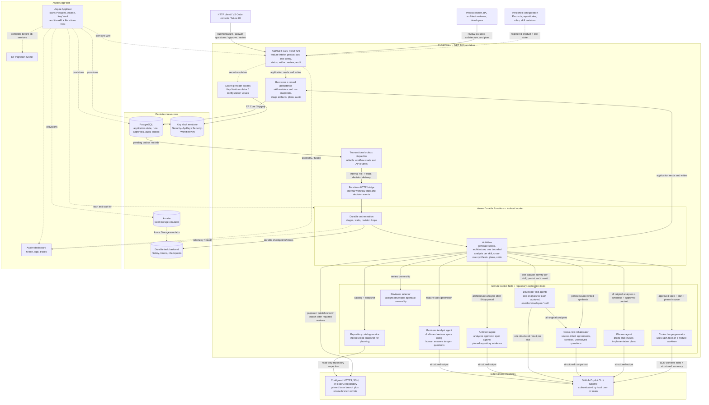

# Collaborator Component Diagram

Current foundation architecture for the solution in
[IMPLEMENTATION_PLAN.md](./IMPLEMENTATION_PLAN.md). This is a .NET 10 REST +
Durable Functions + Copilot SDK workflow. Solid arrows represent requests or data
flows; dotted arrows represent configuration, coordination, or observability.

## Architecture boundaries

- The REST API is the system boundary for client requests and human approval responses.
  Development API-key-protected calls resume Durable waits; actor labels are not verified identities.
- Workflow ordering is BA specification approval, repository-grounded architecture
  analysis and human approval, then developer plan review. Architecture evidence is
  checked against the run's inspected snapshot; the artifact records input revisions,
  skill revision, and pinned commit.
- Enabled `developer-*` skills are snapshotted at submission. The workflow processes
  every captured skill in an independent bounded activity against the same
  approved context and repository snapshot. Results are persisted individually,
  checked for complete one-to-one coverage, then compared in a separate synthesis
  stage. Agreements, conflicts, and unresolved questions link to exact skill
  revisions. Planning receives both the complete original results and synthesis;
  human reviewers see them before approving the plan.
- The Aspire AppHost composes local development dependencies: PostgreSQL, Azurite,
  the Key Vault emulator, the API, and the Azure Functions host.
- PostgreSQL is the authoritative application database for runs, approvals, outbox records,
  and audit state. The Durable task backend tracks workflow execution progress and timers.
- Copilot agents receive on-demand read-only tools over the run-pinned repository.
  After plan approval, only the implementation agent receives all SDK built-ins
  and works directly in a temporary feature worktree at the pinned commit. The
  workflow collects and validates Git changes before publishing the review branch.
  The worktree is not an OS sandbox; shell tools can access resources available
  to the service identity.
- Repository URLs support HTTPS, SSH, and local `file://` sources with a configurable
  base branch. Remote access uses the host's existing Git/SSH credentials; managed
  credential provisioning, hosted pull requests, merge, and deployment are not
  implemented. The implementer can run builds/tests through SDK tools, but there
  is no independent build/test gate before publication.
- Outbox delivery retries up to ten times. The orchestration has no explicit
  activity retry policy; activity failures record a failed run. Selected AI
  artifact types get one same-session validation correction, which is not a
  Durable activity retry.
- The Key Vault emulator and user-secret seeding are development-only. Production
  identity and secret-management behavior have not been validated.
