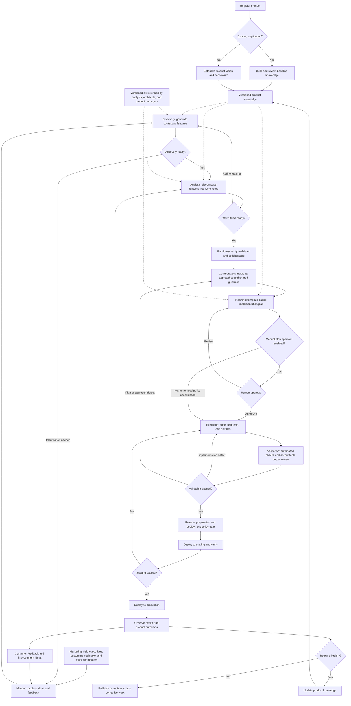

# Collaborator: Agentic Application Development Pipeline

**Document status:** Draft for stakeholder review  
**Version:** 0.2  
**Date:** 2026-10-15

This is a target product specification, not a claim that every stage or
acceptance scenario is implemented. Section 2.2.1 distinguishes the current
foundation from planned delivery; operational behavior is documented in the
[Code README](Code/README.md).

## 1. Purpose and vision

Collaborator is a proposed workflow platform that uses an SI/AI agentic framework to turn product ideas and customer feedback into applications and enhancements deployed to production.

The journey begins with input from marketing teams, executives working in the field, and anyone else with an idea that could improve the product. Specialized AI components progressively transform that input into features, actionable work items, collaborative implementation guidance, implementation plans, code, tests, and deployable artifacts.

The long-term goal is minimal routine human interaction. Initially, people refine agent skills, collaborate on technical approaches, approve plans, and validate generated outputs. Automation increases only after evidence demonstrates that a stage can operate reliably within approved policies.

## 2. Interpretation and scope

### 2.1 Requirements from the narrative

- Anyone can contribute product ideas, requirements, and customer feedback.
- An existing application must first be used to establish baseline product knowledge.
- Discovery generates features in the context of the product.
- Analysis decomposes features into work items.
- Product analysts, architects, and product managers refine relevant agent skills during early adoption.
- Each work item receives one randomly assigned engineer responsible for validating its final output and a randomly assigned group of engineering collaborators.
- Every assigned participant explicitly describes an implementation approach, such as pseudocode, and works with the others to develop shared guidance.
- Planning generates a template-based implementation plan for an extension to an existing component or a new component.
- Plan approval is manual initially and may later be disabled.
- Execution generates code, unit tests, and other required artifacts.
- The overall journey ends with production deployment and aims to reduce human intervention over time.

### 2.2 Proposed extensions needed for end-to-end delivery

The narrative details stages through Execution but does not specify production release mechanics. This specification proposes **Validation**, **Release and Deployment**, and **Observation and Feedback** stages to complete the journey. It also proposes orchestration, traceability, security controls, and measurable autonomy gates.

These additions are design proposals, not previously agreed requirements. The exact meaning of "SI," deployment target, assignment eligibility rules, and numerical quality thresholds remain open decisions. The implementation stack and API boundary below have been selected.

### 2.2.1 Selected implementation direction

- C# on .NET 10 with GitHub Copilot SDK-backed stage agents, on-demand read-only repository tools, feature-worktree implementation with SDK built-ins, and Durable workflow orchestration. The implementation worktree is not an OS sandbox.
- Azure Durable Functions owns workflow stages, revision loops, and persistent human-input waits. The current orchestration has no explicit activity retry policy; outbox delivery retries and selected same-session AI output corrections are separate mechanisms.
- All feature intake and user/admin interactions are REST operations; feature text submission starts processing asynchronously. A UI may be added later without owning workflow coordination.
- PostgreSQL stores authoritative product configuration, developer/role assignments, feature state, approvals, audit, and outbox intents.
- Product configuration currently identifies one Git source and an optional base branch; remote access uses host-provisioned Git/SSH credentials. Per-repository managed credential references are planned. Tokens must never appear in committed configuration, prompts, or workflow history.
- Separate agent definitions and reusable skills support planning, architecture, development, and validation responsibilities.
- .NET Aspire provides local F5 startup and resource observability with PostgreSQL, Azurite, and a local Key Vault emulator. Local user secrets seed the emulator for development; the current planner mode is `Copilot`.
- `Agents:Mode=Copilot` is the normal local execution mode; explicit `Offline` providers support deterministic tests.

The [implementation plan](IMPLEMENTATION_PLAN.md) describes staged delivery.
The [current foundation](Code/README.md) implements the BA specification review
and developer plan-approval flow, repository-grounded human-reviewed architecture,
all-captured developer-skill analyses, cross-role synthesis, on-demand repository
exploration, a validated bounded functionality catalog, worktree implementation,
and review-branch publication for HTTPS, SSH, and local Git sources, with a
configurable base branch pinned per run. The implementer can execute commands,
including builds/tests, using SDK tools. Independent validation or a required
passing build/test gate, hosted pull requests, merge, and deployment are not
implemented. Shared development keys and actor labels are not production
identity or role authorization.

Users define specialist expertise and deliverables through editable skill
prompts. Each submission may select a subset by role/domain/skill key, omit
selection to capture enabled registry defaults, or select an empty set.
An empty set skips specialist model calls and synthesis, not BA, architecture,
or human plan approvals. A user-defined QA prompt can request unit tests and a
QA test plan without making those requirements hardcoded role behavior.
Planning does not establish that tests ran or that QA/UAT signed off.

### 2.3 In scope

- Existing-product onboarding and knowledge maintenance.
- Idea intake, feature discovery, and work-item analysis.
- Human-engineer collaboration and agent skill management.
- Implementation planning, code generation, and test generation.
- Verification, release preparation, production deployment, and feedback.
- Stage orchestration, approvals, audit history, and gradual autonomy.

### 2.4 Out of scope for the initial release

- Training a foundation model from scratch.
- Unrestricted agent access to production or customer data.
- Removing accountable ownership or bypassing quality controls.
- Building a mandatory product UI before the REST workflows are available.
- Automatically generating or releasing code before repository grounding, identity, and quality gates are implemented.

## 3. Actors and responsibilities

| Actor | Responsibilities |
|---|---|
| Idea contributor | Submit ideas, customer feedback, supporting evidence, and desired outcomes. Includes marketing, field executives, and other contributors. |
| Product analyst | Refine Discovery and Analysis skills; review feature intent, ambiguity, and acceptance criteria. |
| Product manager | Set product priorities and scope; refine Analysis skills and review business outcomes. |
| Architect | Refine Analysis and Planning skills; define architectural constraints and review consequential technical changes. |
| Assigned validation engineer | Contribute an implementation approach and remain accountable for validating the work item's final output. |
| Collaborating engineers | Each provide an explicit approach, review alternatives, and jointly develop implementation guidance. |
| Release owner or operator | Proposed role: manage release policy, production approval where required, rollback, and operational readiness. |
| Platform administrator | Manage access, agent configuration, integrations, skill versions, and autonomy policies. |
| AI agents | Produce stage-specific artifacts using approved skills, product context, and permitted tools. |
| Workflow orchestrator | Enforce stage dependencies, route artifacts, manage approvals and exceptions, and maintain execution state. |

One person may hold multiple roles where organizational policy permits. Agent execution does not transfer human accountability to the model.

## 4. Proposed workflow

The baseline is a prerequisite to context-dependent Discovery for an existing application. Idea collection may happen while onboarding is underway.

**Text equivalent:** Product onboarding and baseline knowledge -> Ideation -> Discovery -> Analysis -> Random assignment -> Collaboration -> Planning -> Configurable plan approval -> Execution -> Validation -> Release preparation -> Staging verification -> Production deployment -> Observation and feedback.

Failure or ambiguity returns the affected artifact to the appropriate earlier stage. New customer feedback re-enters Ideation; verified product changes refresh baseline knowledge.

## 5. Stage specifications

### 5.1 Baseline knowledge: existing-product onboarding

**Objective:** Establish a trustworthy understanding of an existing application before generating contextual features.

**Inputs:** Source repositories, available documentation, architecture diagrams, API contracts, data models, tests, deployment configuration, known issues, and authorized operational evidence.

**Required behavior:**

- Inventory existing capabilities, components, interfaces, dependencies, and supported user journeys.
- Identify coding conventions, architectural boundaries, nonfunctional constraints, and delivery practices.
- Record evidence sources, repository revisions, ingestion dates, access restrictions, gaps, and contradictions.
- Distinguish verified facts from inferred behavior and unresolved questions.
- Obtain a designated reviewer decision that the baseline is sufficient for the intended scope; incomplete knowledge must not be represented as complete.
- Refresh relevant knowledge after accepted product changes and detect stale context before planning or execution.

**Outputs:** Versioned product knowledge, capability inventory, architecture summary, source references, constraints, and a knowledge-gap register.

**Exit condition:** A reviewed baseline is available for the relevant product scope. For a new application, use an initial product brief, vision, and constraints instead of inventing an existing architecture.

### 5.2 Ideation

**Objective:** Capture potential improvements from all contributors.

**Inputs:** Ideas, field notes, customer requirements, feedback, observed problems, and supporting evidence.

**Required behavior:**

- Capture the problem, intended users, desired outcome, source, product, and evidence where available.
- Accept incomplete ideas without forcing contributors to specify implementation details.
- Detect related or duplicate submissions while preserving contributor attribution and original evidence.
- Allow contributors to add information and track an idea's disposition.
- Flag ambiguity, conflicting feedback, and sensitive content for appropriate handling.

**Outputs:** Traceable idea records ready for Discovery, or requests for clarification.

**Exit condition:** The idea has enough information to evaluate, or explicitly recorded assumptions that Discovery must resolve.

### 5.3 Discovery

**Objective:** Translate ideas into a coherent feature set within the context of the product.

**Inputs:** Idea records, current product knowledge, product strategy, and Discovery skills.

**Required behavior:**

- Identify the customer problem, target users, desired outcomes, and affected capabilities.
- Generate candidate features with scope, exclusions, rationale, assumptions, and initial acceptance criteria.
- Explain how each feature extends, replaces, or introduces product behavior.
- Identify overlap with existing capabilities and conflicts with product constraints.
- Enable a product analyst to refine the agent's skillset and review its results during early adoption.
- Preserve source links and surface unresolved decisions rather than inventing stakeholder intent.

**Outputs:** Versioned feature specifications and a Discovery decision record.

**Exit condition:** Features are sufficiently clear for decomposition and unresolved blockers are addressed. Review may become policy-driven as autonomy increases.

### 5.4 Analysis

**Objective:** Break each feature into implementable work items.

**Inputs:** Feature specifications, product knowledge, architecture constraints, and Analysis skills.

**Required behavior:**

- Create bounded work items with descriptions, acceptance criteria, dependencies, affected components, risks, and verification expectations.
- Identify work involving design, APIs, data changes, UI, infrastructure, documentation, migration, and testing where applicable.
- Maintain feature-to-work-item traceability and distinguish required work from optional improvements.
- Detect dependencies and produce an execution order; identify cycles or blocked work explicitly.
- Allow product analysts, architects, and product managers to refine skills and review decomposition during early adoption.

**Outputs:** Work-item backlog, dependency graph, and analysis decisions.

**Exit condition:** Each work item is understandable, verifiable, and ready for collaboration once its prerequisites are satisfied.

### 5.5 Collaboration

**Objective:** Turn individual engineering approaches into explicit, shared implementation guidance.

**Inputs:** A ready work item, feature context, current product knowledge, and assignment policy.

**Required behavior:**

- Randomly assign one developer or engineer as the accountable final-output validator.
- Randomly select a group of other engineers as collaborators; the validator must not occupy a collaborator slot.
- Apply randomness within a configured eligible pool, record the selected participants and policy, and prevent duplicate assignments within the same work item.
- Require every assigned participant, including the validator, to submit an explicit implementation approach or pseudocode.
- Support shared discussion, comparison of approaches, identification of trade-offs, and resolution of disagreements.
- Feed the individual contributions and synthesized guidance into the Planning agent without discarding alternative approaches or unresolved concerns.
- Handle unavailable participants or an insufficient eligible pool through a visible reassignment or escalation process.

**Outputs:** Assignment record, individual approaches, collaboration discussion, shared technical guidance, and unresolved concerns.

**Exit condition:** Required contributions are present and the agreed guidance is ready for planning. Collaborator count, eligibility constraints, response deadlines, and disagreement resolution rules must be configured before use.

### 5.6 Planning

**Objective:** Generate a concrete implementation plan using an approved template.

**Inputs:** Work item, collaborative guidance, baseline knowledge, and Planning skills.

**Required behavior:**

- Decide whether to extend existing components, create new components, or use a combination, and explain the choice.
- Describe implementation steps, impacted interfaces, dependency order, data changes, tests, documentation, and deployment implications.
- Follow the versioned plan template defined in Section 7.
- Explicitly address acceptance criteria, architectural constraints, and concerns raised during collaboration.
- Require manual approval initially and support revision or rejection with recorded reasons.
- Permit manual approval to be disabled later through an explicit, auditable policy change; automated quality and risk checks remain mandatory.
- Invalidate approval if material plan changes occur after approval.

**Outputs:** Versioned implementation plan, policy-check results, and approval or revision decision.

**Exit condition:** The current plan is manually approved or authorized by the configured automated policy.

### 5.7 Execution

**Objective:** Implement the approved work item and generate supporting artifacts.

**Inputs:** Authorized plan, pinned source revision, product context, approved tools, and execution constraints.

**Required behavior:**

- Generate code that follows repository conventions and the approved plan.
- Generate unit tests and additional tests needed to verify acceptance criteria.
- Update directly affected documentation, configuration, API contracts, and migration artifacts as needed.
- Work in an isolated branch or equivalent workspace; do not write directly to production.
- Run available build and test checks and record results, changed files, and tool actions.
- Detect material deviations or newly discovered requirements and route them back for collaboration or replanning.
- Produce an explicit failure or blocked status when execution cannot complete.

**Outputs:** Reviewable change set, tests, relevant artifacts, execution log, and preliminary verification results.

**Exit condition:** A reproducible candidate implementation is ready for Validation.

### 5.8 Validation (proposed)

**Objective:** Verify generated output independently of the generation process.

**Required behavior:**

- Run configured build, lint, type, unit, integration, security, and acceptance checks as applicable.
- Map evidence to each acceptance criterion; test generation alone is not proof of correctness.
- Have the assigned engineer validate final output under the initial operating policy.
- Record defects and return work to Execution, Planning, or Collaboration according to the root cause.
- Prevent release when required checks fail, evidence is missing, or applicable approval is absent.

**Outputs:** Validation report, acceptance-criterion evidence, defect records, and validator decision.

**Exit condition:** Required checks and final-output validation pass. Any future replacement of mandatory human validation requires a separate approved policy decision; disabling plan approval does not disable this responsibility.

### 5.9 Release and Deployment (proposed)

**Objective:** Deliver validated work safely to production.

**Required behavior:**

- Assemble a versioned release candidate with dependencies, release notes, and rollback or containment instructions.
- Re-run relevant checks on the integrated candidate when multiple work items are combined.
- Enforce environment-specific permissions and production approval policy.
- Deploy to staging and verify configured smoke tests and integration behavior.
- Deploy the verified artifact to production using the approved delivery mechanism.
- Record artifact identifiers, environment, deployment time, configuration references, and release outcome.
- Recover from a failed deployment through a tested rollback or containment procedure, accounting for data migrations that cannot be simply reversed.

**Exit condition:** The production release is deployed and post-deployment health checks pass; otherwise, the release is explicitly failed or under recovery.

### 5.10 Observation and Feedback (proposed)

**Objective:** Close the loop between delivery, customer outcomes, and product learning.

**Required behavior:**

- Observe release health, regressions, and feature outcomes using authorized telemetry.
- Route incidents to corrective work and product feedback to Ideation.
- Refresh knowledge after verified changes.
- Propose skill improvements from review corrections and operational evidence.
- Evaluate skill changes before activation; do not silently rewrite approved skills based on unverified feedback.

**Outputs:** Operational evidence, outcome measurements, new ideas, knowledge updates, and proposed skill revisions.

## 6. Logical architecture

The design is framework-neutral. A single model may serve multiple agent roles, but their responsibilities, permissions, inputs, and outputs must remain explicit.

| Component | Responsibility |
|---|---|
| Intake and collaboration interface | Idea submission, contributor discussion, engineering approaches, approvals, and status visibility. |
| Workflow orchestrator | Durable state, stage transitions, dependency scheduling, retries, cancellation, and escalation. |
| Product knowledge service | Versioned, access-controlled retrieval of product facts and supporting evidence. |
| Skill registry | Versioned instructions, templates, examples, allowed tools, evaluation cases, and activation history. |
| Stage agents | Discovery, Analysis, Planning, Execution, and proposed verification/release assistance. |
| Policy and approval service | Risk classification, autonomy settings, permission checks, required evidence, and approvals. |
| Integration layer | Source control, work tracking, CI/CD, artifact storage, notifications, and observability. |
| Artifact and audit store | Linked stage artifacts, provenance, contributions, decisions, tool actions, and execution evidence. |

Agents must receive only the context and tool permissions needed for their stage. The orchestrator, not an agent's free-form assertion, determines whether a stage may advance.

## 7. Core artifacts and templates

Every versioned artifact must include an identifier, product identifier, schema version, revision, status, author or generating agent, timestamps, provenance, and links to its upstream artifacts. Agent-generated artifacts must also identify the skill version and model configuration used.

| Artifact | Required content beyond common metadata |
|---|---|
| Product baseline | Capability inventory, architecture, constraints, source revisions, evidence, knowledge gaps, freshness information. |
| Idea | Problem or opportunity, submitter, customer context where authorized, desired outcome, evidence, related ideas. |
| Feature | Source ideas, users, outcome, scope, exclusions, acceptance criteria, assumptions, priority and decision rationale. |
| Work item | Parent feature, bounded task, acceptance criteria, dependencies, affected areas, risks, verification expectations. |
| Collaboration record | Assigned validator, collaborators, selection policy, individual approaches, shared guidance, disagreements and resolution. |
| Implementation plan | Component strategy, ordered steps, contract and data changes, test strategy, operational implications, approvals. |
| Execution result | Plan revision, source revision, change-set reference, generated artifacts, commands, results, deviations. |
| Validation report | Candidate revision, criterion-to-evidence mapping, automated checks, defects, assigned validator decision. |
| Release record | Included work items, artifact identifier, environment, readiness evidence, deployment outcome, recovery procedure. |
| Skill definition | Stage, instructions, input/output contract, examples, tools, constraints, evaluation results, owner, activation status. |

### Implementation plan template

1. Work-item identifier, plan revision, and source/context revisions.
2. Goal, scope, exclusions, and acceptance criteria.
3. Summary of collaborative guidance and resolved trade-offs.
4. Existing-component extensions and new components, with rationale.
5. Ordered implementation steps and dependencies.
6. Interface, schema, configuration, and migration changes.
7. Unit, integration, acceptance, and relevant nonfunctional test strategy.
8. Security, privacy, performance, and operational risks.
9. Documentation, observability, and release artifacts.
10. Deployment and recovery considerations.
11. Open questions, assumptions, and blockers.
12. Required approvals and authorization evidence.

## 8. Orchestration and lifecycle rules

- Track each work item independently; dependency-ready items may proceed concurrently.
- Track stages using explicit states: `not_started`, `ready`, `running`, `awaiting_input`, `awaiting_approval`, `blocked`, `completed`, `failed`, or `cancelled`.
- Advance only when required upstream artifacts and exit conditions are satisfied.
- Persist progress so interrupted runs can resume without duplicating assignments, change sets, or deployments.
- Associate every downstream artifact with the exact upstream revisions used. Mark affected downstream outputs stale when upstream intent, source, skills, or policy changes materially.
- Use bounded retries for transient tool failures. Escalate exhausted retries and substantive requirement, policy, or validation failures instead of hiding them.
- Record rejection, cancellation, reassignment, retry, and rollback decisions.
- Recheck source compatibility and relevant validation after integration changes; a passing isolated work item does not guarantee a passing release.
- Support an authorized pause or stop at any stage.

## 9. Progressive autonomy and skill refinement

Autonomy is configured by stage, product, and risk class, not as an unrestricted global switch.

| Phase | Operating model | Human involvement |
|---|---|---|
| 1. Assisted | Agents produce drafts and implementations under close supervision. | Skills are actively refined; Discovery and Analysis reviewed; every engineer contributes; plans manually approved; final outputs validated by assigned engineers. |
| 2. Guarded automation | Qualified low-risk stages advance through automated checks. | People handle ambiguity and exceptions; plan approval may be disabled for approved categories; collaboration and output-validation duties remain unless separately changed. |
| 3. High autonomy | Most qualified routine work proceeds automatically within policy. | Humans remain accountable for policy, exceptional risk, incidents, and any duties not explicitly retired. |

Promotion requires agreed evaluation cases, measured quality, representative successful runs, acceptable incident and rework rates, and an approved rollback to a more supervised phase. Numerical thresholds and observation windows must be agreed before promotion.

Skill refinement must use versioned changes, regression evaluations, approval by the skill owner, and a recoverable activation history. Reduced need for input is an objective, not a guarantee that the system can safely eliminate review.

## 10. Quality, security, and operational requirements

- **Traceability:** A production change must be traceable back through its work items and features to originating ideas or approved corrective work.
- **Evidence grounding:** Product claims must cite available evidence and label uncertainty.
- **Access control:** Enforce role-based, least-privilege permissions for people, agents, tools, and environments.
- **Data handling:** Minimize and protect customer information; define retention, redaction, and model-provider data-use policies before ingestion.
- **Untrusted inputs:** Treat feedback, repository content, retrieved documents, and tool output as data, not authority to override policies or disclose secrets.
- **Credential protection:** Use approved secret storage; exclude credentials from prompts, generated code, and audit output.
- **Execution isolation:** Limit agent commands, network access, resource consumption, and deployment capabilities.
- **Auditability:** Retain attributable decisions and sufficient execution evidence without retaining unnecessary sensitive content.
- **Reliability:** Use durable workflow state, idempotent side effects, bounded retries, and recoverable releases.
- **Observability:** Expose stage status, blockers, failures, cost, duration, and release health.
- **Cost control:** Configure per-run tool, token, time, and spending budgets with explicit behavior when limits are reached.
- **Maintainability:** Keep skills, templates, policies, and integrations versioned and testable.

Latency, throughput, retention, availability, and recovery objectives are to be agreed for the intended operating environment.

## 11. Acceptance scenarios

| ID | Scenario | Expected result |
|---|---|---|
| AC-01 | An existing application is registered. | Baseline knowledge is built with source references and reviewed before contextual Discovery proceeds. |
| AC-02 | A new application has no source baseline. | Discovery uses an explicit product brief and constraints without claiming nonexistent capabilities. |
| AC-03 | Marketing, a field executive, or another contributor submits an idea. | A traceable idea is recorded and can enter Discovery; missing information is visible. |
| AC-04 | Discovery receives an idea about an existing capability. | Features reflect current product context, cite relevant evidence, and preserve the originating idea. |
| AC-05 | Analysis receives a feature. | Work items have acceptance criteria, dependency relationships, and links to the feature. |
| AC-06 | A work item enters Collaboration. | One eligible validator and the configured number of distinct other collaborators are randomly assigned with a recorded selection policy. |
| AC-07 | One assigned participant has not supplied an approach. | Collaboration cannot complete; the missing contribution and escalation path are visible. |
| AC-08 | Planning produces a component extension or a new-component design. | The plan follows the approved template and addresses collaborative guidance and acceptance criteria. |
| AC-09 | Manual plan approval is enabled. | Execution cannot start without approval of the current plan revision. |
| AC-10 | Manual plan approval is disabled by authorized policy. | Execution proceeds only when automated authorization checks pass; other review duties are unaffected. |
| AC-11 | Execution completes. | A reviewable change set, generated unit tests, applicable artifacts, and recorded check results exist. |
| AC-12 | A required check fails or the assigned validator rejects output. | Release is blocked and the defect is routed to the appropriate stage. |
| AC-13 | Validated work is ready for production. | The integrated release passes applicable checks, staging verification, and production policy before deployment. |
| AC-14 | Production health checks fail. | The release is visibly failed, recovery is initiated according to policy, and corrective work is created. |
| AC-15 | Feedback arrives after release. | It is linked to the product or release and enters Ideation; verified changes update knowledge. |
| AC-16 | A skill or upstream artifact materially changes. | Affected downstream artifacts are identified as stale and reevaluated before further execution. |
| AC-17 | A run is interrupted after a side effect. | Resume does not duplicate that side effect and retains the audit chain. |

## 12. Success measures

Measure outcomes per stage and risk category, with human effort tracked separately from agent activity:

- Idea-to-production lead time.
- Percentage of work items reaching production without corrective rework.
- Acceptance-criterion pass rate and escaped defects.
- Human interventions and human effort per delivered work item.
- Plan rejection and revision rates.
- Random assignment distribution, participant availability, and collaboration completion time.
- Deployment success rate, rollback rate, and recovery time.
- Knowledge freshness and proportion of unsupported agent claims.
- Cost per accepted feature and completed work item.
- Customer outcome improvement against each feature's intended result.

Minimal interaction must not be achieved by suppressing failures, skipping collaboration requirements, weakening validation, or hiding necessary decisions.

## 13. Proposed delivery increments

1. **Foundation:** Product registration, baseline ingestion, idea intake, artifact storage, traceability, and skill versioning.
2. **Discovery and Analysis:** Contextual feature generation, work-item decomposition, dependency tracking, and role-based review.
3. **Collaboration and Planning:** Random assignment, individual approaches, shared guidance, plan templates, and manual approval.
4. **Execution and Validation:** Isolated implementation, generated tests, CI integration, criterion-based validation, and assigned-engineer sign-off.
5. **Production loop:** Staging, release policy, production deployment, recovery, observation, and feedback ingestion.
6. **Autonomy expansion:** Evaluate measured results and selectively reduce review requirements under approved policies.

The first end-to-end pilot should retain human review gates and use a limited product scope and a recoverable deployment target.

## 14. Decisions required before implementation

| Decision | Why it matters |
|---|---|
| Meaning and intended role of SI | Avoids assuming a specific framework or capability from an undefined term. |
| Initial product and supported technology stack | Defines ingestion, generation, test, and deployment integrations. |
| Agent framework and model-provider policy | Determines orchestration interfaces, data controls, cost, and deployment constraints. |
| Eligible engineer pool, collaborator count, and assignment fairness | Makes random assignment implementable while addressing availability and workload. |
| Collaboration disagreement and timeout policy | Determines when work advances, is reassigned, or is escalated. |
| Discovery, Analysis, and plan templates and reviewers | Establishes stage contracts and authority. |
| Baseline sufficiency and refresh criteria | Defines which knowledge gaps block work and when context becomes stale. |
| Risk classes and autonomy promotion thresholds | Determines which actions may become automatic and with what evidence. |
| Future of mandatory human collaboration and output validation | These requirements remain active even when plan approval is turned off; changing them requires explicit agreement. |
| Production approval, deployment, and recovery strategy | Defines authority, safe release behavior, and migration recovery. |
| Data retention, customer-data handling, and audit requirements | Establishes privacy, compliance, and operational controls. |
| Quantitative performance, reliability, quality, and budget targets | Makes acceptance and autonomy decisions measurable. |
